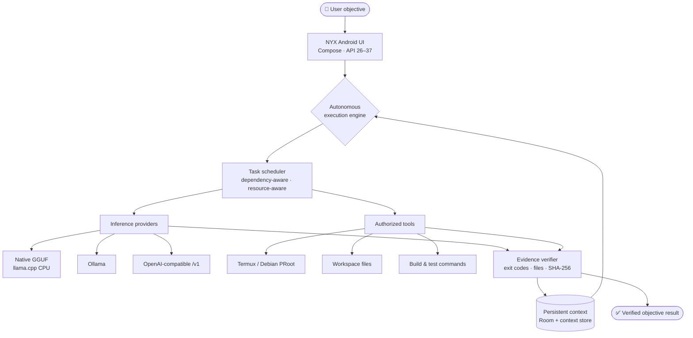

<div align="center">


# NYX ECLIPSE AI

### Your Intelligence. Your Device. Your Rules.

**A free and open-source, local-first Android AI workstation** — on-device language models, autonomous objectives, real execution tools, and persistent agent workflows in one application.

[](https://github.com/ShamelesAbyss/Nyx/releases/tag/v0.6.1)
[](#requirements)
[](#build-from-source)
[](#requirements)

[](LICENSE)
[](LICENSE)
[](#requirements)

</div>

---

## ⬇️ Download NYX v0.6.1 — Project Awakening

<div align="center">

### [**Get the latest release →**](https://github.com/ShamelesAbyss/Nyx/releases/tag/v0.6.1)

| Asset | What it is |
| :--- | :--- |
| **[NYX-v0.6.1.apk](https://github.com/ShamelesAbyss/Nyx/releases/download/v0.6.1/NYX-v0.6.1.apk)** | The application. ARM64, debug-signed. |
| **[NYX-Source-v0.6.1.zip](https://github.com/ShamelesAbyss/Nyx/releases/download/v0.6.1/NYX-Source-v0.6.1.zip)** | Complete source, tests, docs, licenses, and Gradle wrapper. |
| **[NYX-v0.6.1-androidTest.apk](https://github.com/ShamelesAbyss/Nyx/releases/download/v0.6.1/NYX-v0.6.1-androidTest.apk)** | Instrumentation tests for device verification. |
| **[NYX-v0.6.1-SHA256SUMS.txt](https://github.com/ShamelesAbyss/Nyx/releases/download/v0.6.1/NYX-v0.6.1-SHA256SUMS.txt)** | SHA-256 digests for every artifact. |

</div>

> [!IMPORTANT]
> **The APK is ARM64-only and debug-signed.** It is a development build, not a Play Store or production-signed release. Install it only on a 64-bit ARM Android device.
>
> Existing **v0.6.0** installations can update **in place** when the signing certificate matches — the published v0.6.1 APK uses the same debug certificate as v0.6.0. Do not uninstall a data-bearing installation just to test an upgrade; back up anything important first.

---

## 🌒 What NYX actually is

NYX is not a chat wrapper around a hosted API. It is an Android application that can hold a long-running objective, break it into a dependency graph, run allowlisted tools on your device, and refuse to call the work finished until local evidence says it is.

The v0.6.1 build keeps the genuine **llama.cpp CPU runtime** and the bounded **inspect → repair → retest** loop, and makes the execution environment trustworthy: isolated Termux-host discovery, strict PRoot-Distro detection, real guest verification, timestamped capability profiles, workspace write checks, development preflight, and goal-aware acceptance that refuses to call a healthy baseline a completed repair.

What it is *not* yet: a fully autonomous developer, a frontier-model replacement, or a system with unrestricted control of your device. The [current status](#-current-status) section states exactly what has been verified and what has not.

---

## ✨ Capabilities

### 🧠 Local AI inference

- **Native GGUF CPU inference** through a bundled llama.cpp runtime and JNI — no Termux and no network required for basic inference.
- **Ollama integration** for a local server on loopback or your network.
- **OpenAI-compatible endpoints** for any `/v1` chat-completions server.
- **Provider-independent architecture**: chat, agents, workflows, and objectives all resolve through one factory, so no provider is hardcoded as the only path.
- **Local model management**: import a GGUF through the Android file picker, inspect its metadata and a qualified memory estimate, then load, stream, stop, unload, or delete the private copy.

### ⚡ Autonomous objectives

- **Persistent objective and task state** in Room, surviving activity destruction and process restarts.
- **Dependency-aware scheduling** over a validated task graph, with transitive blocking when a prerequisite fails.
- **Resource-conscious concurrency** derived from real memory, thermal state, battery, and storage.
- **Service-owned execution** in a foreground service with leases, heartbeats, and durable checkpoints.
- **Pause and cancellation** from the notification or the app, with uncertain work marked for review rather than silently replayed.

### 🛠️ Real execution tools

- **Termux command bridge** over the documented `RUN_COMMAND` intent, with real stdout, stderr, and exit codes.
- **Terminal environment discovery** for the Termux host, installed tools, and available PRoot distributions.
- **Debian PRoot support** using the proot-distro executable actually discovered on the device.
- **Workspace-scoped file tools** confined to an explicitly approved directory.
- **Project detection** for common build systems, with missing-toolchain reporting instead of blind retries.
- **Build and test commands** fixed by detected project markers — a model cannot substitute its own shell text.

### 🔍 Evidence-driven verification

- **Exit-code validation** from actual process results.
- **File existence and content checks**, plus **SHA-256** comparison.
- **Task evidence records** persisted separately from model prose.
- **Conservative recovery**: read-only work may retry; anything that may have changed state requires explicit human review.

### 🐧 Environment intelligence

- **Isolated host discovery** — probes run through `$PREFIX/bin/bash --noprofile --norc` with `BASH_ENV`/`ENV` cleared, so a Termux startup profile that auto-enters Debian cannot masquerade as the host.
- **Strict PRoot-Distro detection** — installed aliases are parsed from real `proot-distro list` output; a failed command is never reported as "none installed".
- **Real guest verification** — a distribution is available only after a command inside it returns the expected marker, HOME, OS, uid, and tool paths.
- **Timestamped capability profiles** — per-tool verified, missing, incompatible, or permission-denied state with paths, versions, free storage, and a workspace write check.
- **Workspace validation** — syntax plus a real existence/write probe, with explicit host-versus-guest path rules.
- **Development preflight** — stable blocker codes for provider, model, environment, workspace, tools, and memory before an objective may start.

### 💻 Verified Autonomous Developer v2

- **Goal-aware acceptance** — repair, feature, diagnosis, and artifact goals carry different criteria.
- **Honest baseline handling** — a passing baseline is `BASELINE_HEALTHY`, not a repair.
- **Feature-completion verification** — a feature needs a changed test and a green suite, or it is `GOAL_NOT_VERIFIED`.
- **Relevance-ranked retrieval** — failing paths, diagnostics, recency, and size rank the context.
- **Batched source reads** — up to 12 files per IPC round trip, with a per-file fallback.
- **Independent evidence** — build/test exit codes and original output, kept separate from model prose.
- **Bounded repair** — configurable iteration, inference-call, time, and file budgets, with exact-hash patches and retained diffs.

### 📱 Android-native experience

- **Kotlin and Jetpack Compose**, with no web wrapper.
- **Dark violet visual identity** with a branded adaptive launcher icon and native splash.
- **Phone and foldable layouts** with a bottom bar, an expanded-width navigation rail, and split panes for agents and workflows.
- **Local-first operation** with no account, no telemetry pipeline, and no mandatory cloud service.
- **Android API 37 target**, **minimum API 26**, edge-to-edge with correct window insets.

---

## 💜 Why NYX exists

Useful AI should not require renting intelligence by the token.

Most capable assistants live behind a subscription, a credit balance, or a cloud account, and every prompt leaves the device. That model is convenient, but it makes local computation a second-class option and puts a permanent meter on curiosity.

NYX takes the opposite position: if you own hardware capable of running a model, you should be able to use that hardware for real work, offline, without asking permission from a billing system. That means:

- **User ownership** — your device, your models, your data, your rules.
- **Open-source development** — the application and its native runtime integration are inspectable and buildable.
- **Privacy-conscious local operation** — inference can stay entirely on the device.
- **Model independence** — swap GGUF files, run Ollama, or point at a compatible server.
- **No mandatory paid API**, **no mandatory cloud account**, and **no mandatory subscription**.

Local inference is still bounded by physics. Model quality, context length, speed, and memory use depend on the device's RAM, thermal headroom, storage, and the weights you choose. A quantized 1–3B model on a phone is useful for focused tasks; it is not a frontier model, and NYX does not pretend otherwise.

---

## 🗺️ How NYX works



The engine plans one bounded task graph, runs only dependency-ready tasks within device limits, records every tool observation, and evaluates declared evidence before a task may complete. A model's claim of success is never accepted as proof.

---

## 🚀 Getting started

NYX supports two independent ways to run a model. You do not need both, and native inference does not require Termux.

### Option A — Native GGUF mode (no Termux, no network)

1. Install `NYX-v0.6.1.apk` on a 64-bit ARM Android device running Android 8.0 (API 26) or newer.
2. Obtain a **compatible instruct-tuned GGUF** file. Start small: a 0.5B–3B model quantized to `Q4_K_M` is a realistic first test. Memory use grows with parameter count and context length.
3. Open **Models → Import GGUF** and pick the file with the Android document picker. NYX copies it into app-private storage and reads its metadata.
4. Review the reported architecture, quantization, context limit, and memory estimate. An incompatible or oversized model is refused rather than attempted.
5. Select the model, choose a context size and thread count, then **Load**.
6. Open **Chat** and send a short prompt. Streaming output can be stopped at any time.

> [!NOTE]
> **Native Android inference has not yet been verified on physical hardware at publication time.** The runtime generated real streamed tokens on a Linux x86_64 host using the same JNI bindings, and the ARM64 library cross-compiles and packages correctly, but on-device GGUF loading and generation still require confirmation. See [current status](#-current-status).

### Option B — Termux, Ollama, or a compatible server

1. Install [Termux](https://termux.dev/) and your preferred local inference server, following that project's own instructions.
2. In **Settings**, set the endpoint:
   - Ollama: `http://127.0.0.1:11434`
   - OpenAI-compatible: `http://127.0.0.1:8080/v1`
3. Tap **Connect** and choose a model from the discovered list.

For the optional terminal tools, all of the following are required — granting one permission does not complete the setup:

```properties
# ~/.termux/termux.properties
allow-external-apps=true
```

Restart Termux after editing the file, then grant NYX the `com.termux.permission.RUN_COMMAND` permission in Android settings. Finally, choose an explicit workspace directory inside NYX and enable terminal tools there.

> [!WARNING]
> Terminal tools are **off by default** and apply only to objectives in the workspace you approve. Enabling them authorizes bounded source edits and execution of the project's own build/test scripts. Those scripts run with Termux's authority and can reach other files or the network — approve only projects you trust. NYX never enables root, never installs packages on its own, and never commits or publishes.

If a LAN server is used on Android 17, the system will also ask for the local-network permission; denying it leaves internet endpoints working while LAN access stops.

---

## 📋 Requirements

| | |
| :--- | :--- |
| **OS** | Android 8.0 (API 26) or newer, up to API 37 |
| **CPU** | 64-bit ARM (`arm64-v8a`) — no x86 or 32-bit-only support |
| **Storage** | Roughly 2–4× the model file size free, plus workspace |
| **Memory** | Depends on model size and context; small models need ~1–2 GB of headroom |
| **Termux** | Optional, only for terminal tools and Debian PRoot workflows |

---

## 📊 Current status

This table separates what exists from what has actually been demonstrated. It is deliberately conservative.

| Status | Area |
| :--- | :--- |
| ✅ **Implemented and build-tested** | Native GGUF provider, model import and management, provider factory, inference admission, objective engine, scheduler, verifier, context store, skills manifests, repair loop, Termux bridge, Android 17 permission handling |
| ✅ **Build-tested** | Debug APK, instrumentation APK, and **350 JVM tests with zero failures, errors, or skips** on a clean build |
| 🧪 **Verified on Linux host only** | Real llama.cpp JNI generation from an Apache-2.0 SmolLM2-135M Q4_K_M GGUF (`The capital of France is Paris.`, 7 selected tokens), plus cancellation, session reuse, callback-error propagation, and safe unload |
| 🧪 **Verified on Linux host only** | Autonomous repair of a genuinely failing fixture: baseline build `0`, baseline test `2`, exact-hash edit, retest build `0` / test `0`, with backup and diff retained |
| 📱 **Confirmed on the owner's Android 17 device** | Termux environment discovery (earlier development cycle) |
| ⏳ **Awaiting physical-device verification** | v0.6.1 isolated Termux-host discovery, PRoot guest verification, capability probes, workspace checks, and development preflight; complete autonomous workflow; native GGUF import, load, stream, cancel, and unload; memory and thermal behavior; Room migration preservation; Keystore tests; notification actions; process-death recovery; fold and unfold layout |
| 🗺️ **Planned** | See the [roadmap](#-roadmap) |

Artifact checks performed on the published build: package `com.nyx.ai`, versionName `0.6.1`, versionCode `7`, target and compile SDK `37`, minimum SDK `26`, `arm64-v8a` only, and the same debug signing certificate as v0.6.0. Full detail is in [TEST_RESULTS.md](TEST_RESULTS.md).

---

## 🧭 Roadmap

These are goals, not completed capabilities.

- **Native Android inference validation and optimization** — confirm real GGUF execution across devices, then tune threads, context, and memory behavior.
- **Improved autonomous software development** — stronger multi-file repair, better diagnosis, and reliable end-to-end completion on Android.
- **Better memory and inference resource management** — more accurate residency accounting and graceful degradation under pressure.
- **More reliable interruption recovery** — clearer ownership, resumable checkpoints, and safer restart decisions.
- **Expanded verified local skills** — more built-in, manifest-validated procedures with no hidden privilege escalation.
- **Improved accessibility and device compatibility** — broader hardware coverage, larger-text support, and clearer failure messaging.
- **Reproducible production release builds** — a documented, independently verifiable signing and release process.

---

## 🧑‍💻 Development

### Build from source

Requirements: JDK 17 or newer, Android SDK with API 37 and Build Tools 36.0.0, NDK 28.2.13676358, CMake 3.22.1, and Python 3 for the SDK policy checks.

```bash
git clone https://github.com/ShamelesAbyss/Nyx.git
cd Nyx
export ANDROID_HOME="$HOME/Android/Sdk"
export JAVA_HOME=/path/to/jdk-21
./gradlew --no-daemon testDebugUnitTest assembleDebug assembleDebugAndroidTest
```

The APK is written to `app/build/outputs/apk/debug/app-debug.apk`. The native runtime is built for `arm64-v8a` only. Full instructions, including SDK policy guards and instrumentation commands, are in [BUILD.md](BUILD.md).

### Documentation

| Document | Contents |
| :--- | :--- |
| [BUILD.md](BUILD.md) | Toolchain, reproducible builds, tests, signing, packaging |
| [USER_GUIDE.md](USER_GUIDE.md) | Setup, models, agents, objectives, terminal, troubleshooting |
| [NYX_DEVELOPMENT_REPORT.md](NYX_DEVELOPMENT_REPORT.md) | What was built, what was verified, what remains |
| [TEST_RESULTS.md](TEST_RESULTS.md) | Exact test counts, host evidence, and unexecuted device checks |
| [CHANGELOG.md](CHANGELOG.md) | Release history |
| [ENGINEERING_STANDARDS.md](ENGINEERING_STANDARDS.md) | Permanent SDK and compatibility policy |
| [PLATFORM_NOTES.md](PLATFORM_NOTES.md) | Android and Termux platform constraints |
| [docs/V061_VERIFIED_DEVELOPER.md](docs/V061_VERIFIED_DEVELOPER.md) | v0.6.1 environment, preflight, and verified-developer details |
| [docs/](docs/) | Native inference, development engine, context and skills, Android compatibility |

### Contributing

Contributions are welcome from Android engineers, local-model researchers, and anyone who wants private AI to work well on real hardware.

- **Bugs and feature requests:** open an [issue](https://github.com/ShamelesAbyss/Nyx/issues) with device, Android version, model file, and reproduction steps.
- **Pull requests:** keep changes focused, preserve the existing architecture, and include tests for deterministic logic.
- **Claims:** report what you actually observed. A build that compiles is not a device validation, and a model that sounds confident is not evidence.

No formal contribution process, CLA, or governance structure is documented beyond the above; treat this as an early-stage project.

### License and attribution

NYX is released under the [Apache License 2.0](LICENSE). The bundled llama.cpp runtime retains its own upstream license and attribution, included in the source archive. Model weights are **not** distributed with NYX; obtain them under terms that permit your use.

---

<div align="center">

## Your Intelligence. Your Device. Your Rules.

**NYX Eclipse AI** · built for the hardware you already own.

<sub>v0.6.1 — Project Awakening · Apache-2.0 · ARM64 · API 26+</sub>

</div>
