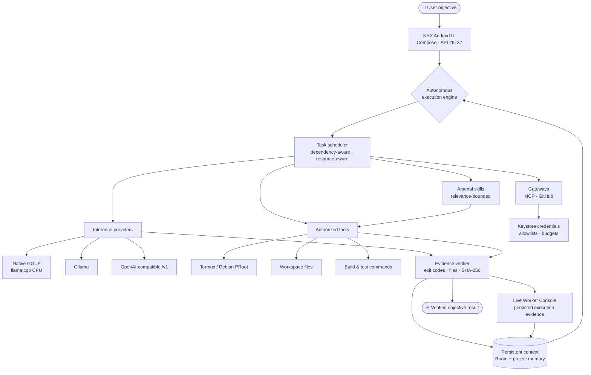

<div align="center">


# NYX ECLIPSE AI

### Your Intelligence. Your Device. Your Rules.

**A local-first Android AI workstation for private inference, real device tools, and autonomous work that has to prove itself.**

[](https://github.com/ShamelesAbyss/Nyx/releases/tag/v0.8.5)
[](#-requirements)
[](#-build-from-source)

[](LICENSE)
[](#-requirements)
[](#local-first-not-cloud-first)

</div>

---

> [!IMPORTANT]
> **NYX v0.8.5 — Project Sovereign is the latest official release.** It moves autonomous work from basic tool execution toward deliberate, evidence-driven execution: adaptive deliberation budgets, a working state that survives context compaction and retries, task-scoped tool authority, a false-success guard, bounded self-repair, and a longer checkpointed execution window. Read the [release notes](RELEASE_NOTES_v0.8.5.md) and [implementation report](V085_IMPLEMENTATION_REPORT.md).

> [!WARNING]
> **The APK is ARM64-only and debug-signed.** It is a development build, not a Play Store or production-signed release. Install it only on a 64-bit ARM Android device. Existing NYX installations signed with the established debug certificate can update in place; back up anything important before experimenting.

## ⬇️ Download NYX v0.8.5 — Project Sovereign

<div align="center">

### [**Get the latest release →**](https://github.com/ShamelesAbyss/Nyx/releases/tag/v0.8.5)

| Asset | What it is |
| :--- | :--- |
| **[NYX-v0.8.5.apk](https://github.com/ShamelesAbyss/Nyx/releases/download/v0.8.5/NYX-v0.8.5.apk)** | Primary installation APK. ARM64, debug-signed. |
| **[NYX-Source-v0.8.5.zip](https://github.com/ShamelesAbyss/Nyx/releases/download/v0.8.5/NYX-Source-v0.8.5.zip)** | Complete source, tests, docs, licenses, and Gradle wrapper. |
| **[NYX-v0.8.5-androidTest.apk](https://github.com/ShamelesAbyss/Nyx/releases/download/v0.8.5/NYX-v0.8.5-androidTest.apk)** | Instrumentation tests for device verification. |
| **[NYX-v0.8.5-SHA256SUMS.txt](https://github.com/ShamelesAbyss/Nyx/releases/download/v0.8.5/NYX-v0.8.5-SHA256SUMS.txt)** | SHA-256 digests for the APKs and source archive. |

</div>

No account, subscription, or mandatory cloud service is required. Model weights are not distributed with NYX; bring a compatible GGUF or connect to a local server.

---

## 🌒 The short version

NYX is not a chat wrapper around a hosted API. It is an Android application that can hold a long-running objective, break it into a dependency graph, run allowlisted tools on your device, and refuse to call the work finished until local evidence says it is.

It is also a private inference workstation. Run a quantized GGUF through the bundled llama.cpp CPU runtime, connect to a managed Ollama server, or point NYX at any OpenAI-compatible endpoint. Chat, agents, workflows, and autonomous objectives all resolve through the same provider layer, so no single cloud vendor is the only path.

Project Sovereign adds the missing layer between a model and a long objective: **a durable, bounded working state**. NYX now adapts its deliberation budget to the task, scopes tools to what the task actually needs, rejects unsupported completion claims, repairs malformed actions a bounded number of times, and carries verified context across retries and process restarts.

| | |
| :--- | :--- |
| **Package** | `com.nyx.ai` |
| **Version** | `0.8.5` (versionCode 18) |
| **Android** | 8.0+ / API 26–37 |
| **Architecture** | `arm64-v8a` |
| **Inference** | Native GGUF CPU · Ollama · OpenAI-compatible `/v1` |
| **License** | Apache-2.0 |

---

## 🧑‍💻 What NYX does for everyday Android users

### A private AI that stays useful offline

Import a GGUF model once and use it without sending every prompt to a subscription service. Native inference runs through llama.cpp on the phone's CPU; no Termux setup is required for basic chat. Small quantized models are useful for drafting, summarizing, explaining, extracting, and focused coding help. A phone is not a frontier-model replacement, and NYX does not pretend it is.

### An assistant that can do more than answer

NYX can plan an objective, save the task graph, run real commands in a verified Termux or Debian PRoot environment, edit files inside an approved workspace, build and test a project, and record what actually happened. The Live Worker Console shows the plan, tool calls, terminal output, verification evidence, and recovery decisions instead of hiding them behind a spinner.

### A runtime that respects the hardware

Eco, Balanced, Performance, and Adaptive modes choose bounded thread counts, autonomous worker concurrency, stream cadence, and idle-release behavior. Thermal and low-battery ceilings apply to every mode. Calibration is opt-in, bounded, and stored on-device. The native session reuses only an exact token prefix and clears its cache on any mismatch or failure.

### A local-first philosophy, not a marketing slogan

Your device, your models, your data, your rules. NYX is open source, buildable, and designed to work without an account or a mandatory paid API. When you connect a remote provider, that is your choice; the local path remains a first-class option.

---

## 🛡️ Project Sovereign

**Project Sovereign is about making autonomous work survive real models, long runs, and its own mistakes.**

NYX already planned objectives, ran authorized tools, and checked evidence. This release adds the layer that keeps those loops coherent when the context is compacted, a tool fails, a model repeats itself, or a process restarts. It is an engineering step toward reliable autonomous execution — not a claim of unbounded or Manus-style autonomy.

### 🧠 Adaptive deliberation

NYX assigns a bounded reasoning depth and hard model, tool, step, and context budgets from the task kind, its complexity, and the observed performance mode. Light tasks get fewer calls; development, diagnosis, and verification get more. The model receives a short operating protocol asking for one decision and one observation at a time — never a hidden chain-of-thought transcript.

### 🤖 Intelligent agent execution

Each task runs a structured loop: plan the next action, invoke only an authorized tool, record the observation, evaluate whether the evidence supports progress, and verify before completion. The planner sees the tools actually enabled for the run instead of guessing at capabilities.

### 🛡️ Evidence-backed completion

For tasks that require tool evidence, a final answer that claims concrete work without a successful tool observation is rejected and the model is asked for evidence or an honest blocker. If it repeats the claim, the result is marked unverified and objective verification fails. An honest blocker is not treated as a completion claim.

### 🔄 Bounded self-correction

Malformed structured actions get at most two repair attempts, each recorded. Repeated identical failing actions stop with an explanation, and consecutive tool failures stop the task before it burns the whole budget. Retries receive the previous failure evidence and an explicit instruction to change approach.

### 💾 Durable working state

Each task persists a compact working state: objective, requirements, established facts, open errors, next action, evidence pointers, and completed steps. It is restored from the task checkpoint after a retry or process restart and included in bounded context. A long objective no longer depends on an ever-growing chat transcript.

### 🔐 Task-scoped capabilities

Tools follow the planned task, not the widest capability the app happens to have:

| Task kind | Allowed capability |
| :--- | :--- |
| Inference | Read-only grounding and enabled non-mutating tools; no shell, file writes, or project execution |
| Filesystem | File inspection and atomic edits; no shell commands or project builds |
| Verification | Read-only inspection plus the fixed test command; no file writes or arbitrary shell |
| Terminal | File tools and policy-gated shell commands inside the authorized workspace |
| Development | Full approved development capability set |

Every scope is intersected with tools actually available on the run, so a missing terminal never becomes a phantom capability.

### ⚡ Resource-aware autonomy

Sovereign reasoning and execution integrate with Project Endurance's Eco, Balanced, Performance, and Adaptive modes. Eco reduces budgets and can release an idle native model; Performance may raise them within fixed caps. Thermal, battery, and memory safeguards still apply.

### Long-running execution

The foreground objective watchdog now allows up to two hours, while the existing lease heartbeat still pauses on thermal, memory, or battery pressure. Checkpoints are written before and after verification, and uncertain mutating work still requires explicit review.

### Performance foundation from v0.8.4

The hardware-aware layer introduced in Project Endurance remains in place.

### Four operating modes

| Mode | Best for | What it changes |
| :--- | :--- | :--- |
| 🔋 **Eco** | Long battery life, small devices, background work | At most two native threads, one autonomous worker, slower UI stream coalescing, and release of the resident native model after ten idle minutes. |
| ⚖️ **Balanced** | Everyday chat and objectives | Moderate native threading, up to two autonomous workers, and 60 ms stream coalescing. |
| ⚡ **Performance** | Fast local generation on capable hardware | More native threads, up to four autonomous workers when the device can sustain them, and 33 ms stream coalescing. |
| 🧠 **Adaptive** | A sensible default across devices | Chooses a level from RAM, low-RAM state, core count, thermal status, and battery state, with hysteresis to avoid oscillation. |

Thermal and battery safety ceilings override every mode. A critical thermal reading or a nearly empty unplugged battery derates the runtime even if Performance was selected. Derating is immediate; upgrading waits for two consecutive observations.

### Device intelligence, not device guesses

The Performance dashboard reports what NYX can actually observe from documented Android and Linux interfaces:

- manufacturer, model, SoC manufacturer/model, hardware, Android release, API level, and supported ABIs;
- logical cores, estimated performance/efficiency core split, maximum observed CPU frequency, and optional CPU flags such as `dotprod`, `i8mm`, `bf16`, and SVE;
- total and available RAM, Android memory class, and the low-RAM flag;
- battery percentage and charging state, `PowerManager` thermal status on Android 10+, display metrics, smallest width, and a hinge/large-screen hint;
- media performance class, NNAPI system-feature presence, and Vulkan feature version when reported.

Missing evidence is labeled unavailable rather than guessed. SoC family labels such as Tensor G5/G4/G3 or Snapdragon 8 Elite are **display and thread heuristics**, not proof that a vendor GPU, NPU, or runtime can accelerate GGUF inference.

### Adaptive threading at safe boundaries

The selected mode's thread count is used before the next native model load. A model that is already resident keeps its exact existing thread count, so a chat turn cannot silently reload the model or change the session underneath a generation.

- The manual **CPU threads** slider in Settings is authoritative and switches adaptive threading off.
- **Apply to native session** reloads the resident model only when no generation, agent, workflow, or objective is running.
- Context length is not silently changed or truncated.

### Calibration with a stop button

Calibration is opt-in and measures real native inference against the currently loaded model:

- at most three thread configurations, derived from the current setting and observed performance-core count;
- at most eight generated tokens per configuration;
- a 120-second total budget, with a thermal recheck between candidates;
- refusal without a loaded native model, during an objective, on a hot device, or on a low unplugged battery;
- restoration of the original configuration in a non-cancellable `finally` path;
- on-device provenance: model path and size, runtime version, device fingerprint, load time, generated tokens, end-to-end tokens/s, thermal/battery conditions, and timestamp.

Results are invalidated when the model, runtime version, or device fingerprint changes, and measurements taken under thermal or battery pressure are not used for tuning. "Tokens/s" is end-to-end throughput for a fixed short prompt, including prompt processing; it is not a decode-only synthetic benchmark.

### Safer native prompt reuse

The native session records the exact token IDs represented in its single-sequence KV memory. On the next generation it finds the longest exact prefix shared with the new formatted prompt and removes only the divergent tail with `llama_memory_seq_rm`. At least one prompt token is always decoded so logits exist for the first sample.

Any mismatch, failed sequence removal, cancellation, decode error, or failed generation clears both the KV memory and the token cache. No prompt history is truncated, slid, or silently rewritten. If reuse is not possible, the existing full-prompt path runs exactly as before.

### What is experimental — and what is not claimed

> [!NOTE]
> **Project Sovereign is build- and JVM-tested, not physically validated in this cycle.** Adaptive deliberation, task-scoped tools, the false-success guard, and durable working state have no on-device run against a real provider or model yet. "Replanning" here means bounded plan repair plus changed-approach retry guidance, not an unrestricted planner loop. No speed, battery, or success-rate benchmark is claimed.
>
> **Native CPU inference remains the verified GGUF backend.** No GPU or NPU GGUF backend is bundled or claimed. NNAPI/Vulkan feature presence is capability evidence, not a compatibility promise.
>
> Exact-prefix KV reuse is implemented and compiled, but it has **no measured device speedup** and no physical-device runtime test yet. Calibration has not been run on a phone with a real GGUF model. Battery or speed improvements have not been quantitatively established.
>
> The release owner reports that the Performance dashboard was opened on a Pixel 10 Pro Fold. That is **UI evidence only**; it does not validate native model loading, calibration, KV reuse, or battery life.

---

## 🧩 What makes NYX different

### Local-first, not cloud-first

Native GGUF inference runs through a bundled llama.cpp runtime and JNI. Basic chat does not require Termux, a network connection, an account, or a paid API. Ollama and OpenAI-compatible endpoints are available when you want them, but they are not the only path.

### One provider layer, several ways to run a model

- **Native GGUF** — import a model through the Android file picker, inspect its metadata and memory estimate, then load, stream, stop, unload, or delete the private copy.
- **Ollama** — connect to a local server on loopback or your network, including a managed Termux or Debian/PRoot-hosted server.
- **OpenAI-compatible `/v1`** — point at any compatible chat-completions server.

### Autonomy with evidence

NYX persists objectives and tasks in Room, plans a validated dependency graph, schedules only dependency-ready work, records tool observations, and evaluates declared evidence before a task may complete. A model's prose is never accepted as proof. Read-only work may retry; anything that may have changed state requires explicit human review.

### Real Android execution

- Termux command bridge over the documented `RUN_COMMAND` intent, with real stdout, stderr, and exit codes.
- Verified Termux host and Debian PRoot guest discovery, with inherited-binary and origin checks.
- Workspace-scoped file tools, explicit workspace authorization, a managed registry, and guarded deletion.
- Task-scoped dependency preparation: only the toolchain actually required by planned work is checked; ordinary shell objectives are not blocked by Android SDK or Gradle.
- Build and test commands fixed by detected project markers — a model cannot substitute its own shell text.

### Safety and control

- Manual, Smart, and Full autonomy modes, with scoped, revocable grants.
- Central risk classification for terminal commands, file changes, package installs, network access, publishing, credentials, and delegated work.
- Emergency Stop that denies new actions immediately and remains active across restarts.
- No root, no hidden APIs, no permission bypass, and no arbitrary model-authored shell execution.
- Gateway tokens use Android Keystore-backed storage; credentials remain references, not plaintext records.

### Android-native experience

Kotlin and Jetpack Compose, with no web wrapper. A phone-first layout with bottom navigation, an expanded-width navigation rail, and split panes for agents and workflows. Standard phones and foldables use the same adaptive app window; a hinge-aware two-pane layout is not claimed. Dark violet visual identity, branded launcher icon, edge-to-edge insets, API 37 target, and minimum API 26.

### Local network and research tools

- `fetch_url` for public documentation and research, HTTPS-only, with private-address, loopback-pivot, and redirect re-validation.
- Arsenal: versioned offline procedures with relevance-bounded injection and untrusted-import validation.
- Gateways: streamable-HTTP MCP and GitHub tools behind per-server allowlists, budgets, timeouts, and redacted logs.
- Project memory: evidence-hashed verified outcomes and lessons injected into later objectives.
- Source symbol index and bounded repair loop for development work.

---

## 🗺️ How NYX works



The engine plans one bounded task graph, runs only dependency-ready tasks within device limits, records every tool observation, and evaluates declared evidence before a task may complete. A model's claim of success is never accepted as proof.

---

## 🚀 Getting started

NYX supports two independent ways to run a model. You do not need both, and native inference does not require Termux.

### Option A — Native GGUF mode (no Termux, no network)

1. Install `NYX-v0.8.5.apk` on a 64-bit ARM Android device running Android 8.0 (API 26) or newer.
2. Obtain a compatible instruct-tuned GGUF file. Start small: a 0.5B–3B model quantized to `Q4_K_M` is a realistic first test. Memory use grows with parameter count and context length.
3. Open **Models → Import GGUF** and pick the file with the Android document picker. NYX copies it into app-private storage and reads its metadata.
4. Review the reported architecture, quantization, context limit, and memory estimate. An incompatible or oversized model is refused rather than attempted.
5. Select the model, choose a context size and thread count, then **Load**.
6. Open **Chat** and send a short prompt. Streaming output can be stopped at any time.

> [!NOTE]
> **Native Android inference has not yet been verified on physical hardware at publication time.** The runtime generated real streamed tokens on a Linux x86_64 host using the same JNI bindings, and the ARM64 library cross-compiles and packages correctly, but on-device GGUF loading and generation still require confirmation. See [current status](#-current-status).

### Option B — Termux, Ollama, or a compatible server

1. Install [Termux](https://termux.dev/) and your preferred local inference server, following that project's own instructions.
2. In **Settings**, set the endpoint:
   - Ollama: `http://127.0.0.1:11434`
   - OpenAI-compatible: `http://127.0.0.1:8080/v1`
   - Or open **Models → Managed Ollama** and use **Start** to launch a Termux-hosted server without leaving NYX.
3. Tap **Connect** and choose a model from the discovered list.

For the optional terminal tools, all of the following are required — granting one permission does not complete the setup:

```properties
# ~/.termux/termux.properties
allow-external-apps=true
```

Restart Termux after editing the file, then grant NYX the `com.termux.permission.RUN_COMMAND` permission in Android settings. Finally, choose an explicit workspace directory inside NYX and enable terminal tools there.

For the optional Debian PRoot guest, install Termux and its `proot-distro` package from the Termux package manager, install or verify a Debian guest with `proot-distro`, then open **Autonomy → Terminal**, select **Debian PRoot**, and run environment detection so NYX verifies the guest alias before use. Do not try to build the Android app inside the ARM64 guest; use Android SDK/Gradle on a supported host. NYX does not require Debian for native GGUF inference or ordinary Chat.

> [!WARNING]
> Terminal tools are **off by default** and apply only to objectives in the workspace you approve. Enabling them authorizes bounded source edits and execution of the project's own build/test scripts. Those scripts run with Termux's authority and can reach other files or the network — approve only projects you trust. NYX never enables root and never commits or publishes. It installs only planner-generated packages approved by policy, never arbitrary model-authored install commands.

If a LAN server is used on Android 17, the system will also ask for the local-network permission; denying it leaves internet endpoints working while LAN access stops.

### Your first autonomous objective

1. Connect a local model in **Chat** and confirm it responds. Native GGUF, Ollama, and OpenAI-compatible local endpoints are separate provider choices.
2. Open **Autonomy → Terminal**, detect/select the Termux host or Debian environment, choose a trusted workspace path, and save it. Enable terminal tools only if the objective needs them; leave them off for planning or chat-only work.
3. Open **Autonomy → Objectives**, enter a small concrete goal and how success can be checked, then choose **Plan and execute**. Review the task plan and any permission or package-approval prompts.
4. Follow task events in **Live Activity**. NYX uses exit codes, files, and declared verification evidence—not the model's claim alone—to decide whether work is complete. If a required dependency is blocked, review `needs_attention` and resume after resolving it.

See the [user guide](USER_GUIDE.md) for the full setup and safety boundaries.

---

## 📋 Requirements

| | |
| :--- | :--- |
| **OS** | Android 8.0 (API 26) or newer, up to API 37 |
| **Form factors** | Phone-first Compose layout with bottom navigation, expanded-width navigation rail, and split panes. Standard phones and foldables use the same adaptive app window; no hinge-aware/two-pane layout or foldable-device validation is claimed. |
| **CPU** | 64-bit ARM (`arm64-v8a`) — no x86 or 32-bit-only support |
| **Storage** | Roughly 2–4× the model file size free, plus workspace |
| **Memory** | Depends on model size and context; small models need ~1–2 GB of headroom |
| **Termux** | Optional, only for terminal tools and Debian PRoot workflows |

---

## 📊 Current status

This table separates what exists from what has actually been demonstrated. It is deliberately conservative.

| Status | Area |
| :--- | :--- |
| ✅ **Implemented and build-tested** | Native GGUF provider, model import and management, provider factory, inference admission, objective engine, scheduler, verifier, context store, Arsenal procedures, repair loop, Termux bridge, autonomy policy, dependency provisioning, network tools, specialist roles, Android 17 permission handling, managed Ollama lifecycle, MCP/GitHub gateways, project memory, source symbol index, Live Worker Console, device intelligence, operating modes, adaptive threading, bounded calibration, exact-prefix KV reuse, mode-aware concurrency and streaming, adaptive deliberation budgets, durable working state, task-scoped tool authority, false-success guard, bounded action repair |
| ✅ **Published** | v0.8.5 ARM64 debug APK, instrumentation APK, source archive, and checksum manifest on GitHub; **731 JVM tests, zero failures/errors/skips across 70 classes**. Instrumentation was compiled but not executed. |
| ✅ **Previous release** | v0.8.4 ARM64 debug APK, instrumentation APK, source archive, and checksum manifest remain available. |
| 📱 **Owner-reported UI check** | Performance dashboard opened on a Pixel 10 Pro Fold. This is UI evidence only; it is not a native inference, calibration, KV-reuse, or battery benchmark. |
| 🧪 **Verified on Linux host only** | Real llama.cpp JNI generation from an Apache-2.0 SmolLM2-135M Q4_K_M GGUF (`The capital of France is Paris.`, 7 selected tokens), plus cancellation, session reuse, callback-error propagation, and safe unload |
| 🧪 **Verified on Linux host only** | Autonomous repair of a genuinely failing fixture: baseline build `0`, baseline test `2`, exact-hash edit, retest build `0` / test `0`, with backup and diff retained |
| 📱 **Confirmed on the owner's Android 17 device** | Termux environment discovery (earlier development cycle) |
| ⏳ **Awaiting physical-device verification** | Native GGUF loading/generation, calibration, Eco idle release, adaptive thread application, exact-prefix KV reuse with a real model, Performance mode switching, v0.8.3 Mission Control/Terminal rendering and fold/unfold behavior, v0.8.2 task-scoped dependency preparation and objective resumption, v0.8.1 console and planning behavior against a real provider, v0.8.0 fixed-build Debian JDK installation and continuation, workspace deletion and startup reuse, Debian-only Ollama discovery/lifecycle, notification actions, model listing, Arsenal/MCP/GitHub/memory/symbol flows, Termux IPC, Keystore, foreground service, process-death recovery, Room migration, and fold/unfold layout |
| 🗺️ **Planned** | See the [roadmap](#-roadmap) |

Artifact checks for the published v0.8.5 build: package `com.nyx.ai`, versionName `0.8.5`, versionCode `18`, target and compile SDK `37`, minimum SDK `26`, `arm64-v8a` only, and the established debug signer. The APK is 16 KB ZIP-aligned. This is a debug-signed development build, not a production-signed Play artifact. See [TEST_RESULTS.md](TEST_RESULTS.md) and the [v0.8.5 checksum manifest](https://github.com/ShamelesAbyss/Nyx/releases/download/v0.8.5/NYX-v0.8.5-SHA256SUMS.txt). No physical-device native inference validation is claimed.

---

## 🧭 Roadmap

These are goals, not completed capabilities.

- **Native Android inference validation and optimization** — confirm real GGUF execution across devices, then tune threads, context, and memory behavior from measured evidence.
- **Improved autonomous software development** — stronger multi-file repair, better diagnosis, and reliable end-to-end completion on Android.
- **Better memory and inference resource management** — more accurate residency accounting and graceful degradation under pressure.
- **More reliable interruption recovery** — clearer ownership, resumable checkpoints, and safer restart decisions.
- **Expanded verified local skills** — more built-in, manifest-validated procedures with no hidden privilege escalation.
- **Improved accessibility and device compatibility** — broader hardware coverage, larger-text support, and clearer failure messaging.
- **Reproducible production release builds** — a documented, independently verifiable signing and release process.

The long-term vision is an autonomous assistant that runs on hardware you own, uses tools you approve, shows its evidence, and stops when it cannot prove the work is correct. NYX is an early step toward that vision, not a claim that it has already arrived.

---

## 📚 Release history

| Version | Codename | Focus |
| :--- | :--- | :--- |
| **[v0.8.5](https://github.com/ShamelesAbyss/Nyx/releases/tag/v0.8.5)** | **Project Sovereign** | Adaptive deliberation budgets, durable working state, task-scoped tools, false-success guard, bounded self-repair, two-hour checkpointed execution |
| [v0.8.4](https://github.com/ShamelesAbyss/Nyx/releases/tag/v0.8.4) | Project Endurance | Device intelligence, Eco/Balanced/Performance/Adaptive modes, calibration, thermal/battery safety, exact-prefix KV reuse |
| [v0.8.3](https://github.com/ShamelesAbyss/Nyx/releases/tag/v0.8.3) | Project Mission Control | Mission overview, readiness evidence, task timeline, terminal clarity, console accessibility |
| [v0.8.2](https://github.com/ShamelesAbyss/Nyx/releases/tag/v0.8.2) | Project Unshackle | Task-scoped dependency preparation, negation-aware project inference, GitHub language presentation |
| [v0.8.1](https://github.com/ShamelesAbyss/Nyx/releases/tag/v0.8.1) | Project Clear Signal | Run-scoped Live Worker Console, operation grouping, bounded planning recovery, shell hardening |
| [v0.8.0](https://github.com/ShamelesAbyss/Nyx/releases/tag/v0.8.0) | Project Autonomous Bootstrap | Dependency bootstrap, Debian Deb822/JDK fix, policy-gated terminal, workspace lifecycle |
| [v0.7.9](https://github.com/ShamelesAbyss/Nyx/releases/tag/v0.7.9) | Project Persistence | Durable Debian/PRoot Ollama lifecycle, foreground ownership, verified readiness and stop |
| [v0.7.7](https://github.com/ShamelesAbyss/Nyx/releases/tag/v0.7.7) | Project Liberation | Debian-aware Ollama, guest lifecycle safety, repeated Full-Autonomy projects |

See [CHANGELOG.md](CHANGELOG.md) for the complete history.

---

## 🧑‍💻 Build from source

Requirements: JDK 17 or newer, Android SDK with API 37 and Build Tools 36.0.0, NDK 28.2.13676358, CMake 3.22.1, and Python 3 for the SDK policy checks.

```bash
git clone https://github.com/ShamelesAbyss/Nyx.git
cd Nyx
export ANDROID_HOME="$HOME/Android/Sdk"
export JAVA_HOME=/path/to/jdk-21
./gradlew --no-daemon testDebugUnitTest assembleDebug assembleDebugAndroidTest
```

The APK is written to `app/build/outputs/apk/debug/app-debug.apk`. The native runtime is built for `arm64-v8a` only. Full instructions, including SDK policy guards, signing boundaries, and instrumentation commands, are in [BUILD.md](BUILD.md).

### Documentation

| Document | Contents |
| :--- | :--- |
| [BUILD.md](BUILD.md) | Toolchain, reproducible builds, tests, signing, packaging |
| [USER_GUIDE.md](USER_GUIDE.md) | Setup, models, agents, objectives, terminal, troubleshooting |
| [NYX_DEVELOPMENT_REPORT.md](NYX_DEVELOPMENT_REPORT.md) | What was built, what was verified, what remains |
| [TEST_RESULTS.md](TEST_RESULTS.md) | Exact test counts, host evidence, and unexecuted device checks |
| [CHANGELOG.md](CHANGELOG.md) | Complete release history |
| [RELEASE_NOTES_v0.8.5.md](RELEASE_NOTES_v0.8.5.md) | Project Sovereign release scope, verification, and limits |
| [V085_IMPLEMENTATION_REPORT.md](V085_IMPLEMENTATION_REPORT.md) | Sovereign execution implementation, safety invariants, test evidence, and device checklist |

<details>
<summary><strong>Historical release and implementation documents</strong></summary>

| Document | Contents |
| :--- | :--- |
| [RELEASE_NOTES_v0.8.3.md](RELEASE_NOTES_v0.8.3.md) | v0.8.3 Project Mission Control |
| [V083_IMPLEMENTATION_REPORT.md](V083_IMPLEMENTATION_REPORT.md) | v0.8.3 implementation and device checks |
| [RELEASE_NOTES_v0.8.2.md](RELEASE_NOTES_v0.8.2.md) | v0.8.2 Project Unshackle |
| [V082_IMPLEMENTATION_REPORT.md](V082_IMPLEMENTATION_REPORT.md) | v0.8.2 dependency classification and gate |
| [RELEASE_NOTES_v0.8.1.md](RELEASE_NOTES_v0.8.1.md) | v0.8.1 Project Clear Signal |
| [RELEASE_NOTES_v0.8.0.md](RELEASE_NOTES_v0.8.0.md) | v0.8.0 Project Autonomous Bootstrap |
| [V080_LIVE_WORKSPACE_REPORT.md](V080_LIVE_WORKSPACE_REPORT.md) | v0.8.0 live console and workspace lifecycle |
| [docs/V081_IMPLEMENTATION_STATUS.md](docs/V081_IMPLEMENTATION_STATUS.md) | v0.8.1 console and planning implementation |
| [ENGINEERING_STANDARDS.md](ENGINEERING_STANDARDS.md) | Permanent SDK and compatibility policy |
| [PLATFORM_NOTES.md](PLATFORM_NOTES.md) | Android and Termux platform constraints |
| [docs/](docs/) | Native inference, development engine, context and skills, Android compatibility |

</details>

### Contributing

Contributions are welcome from Android engineers, local-model researchers, and anyone who wants private AI to work well on real hardware.

- **Bugs and feature requests:** open an [issue](https://github.com/ShamelesAbyss/Nyx/issues) with device, Android version, model file, and reproduction steps.
- **Pull requests:** keep changes focused, preserve the existing architecture, and include tests for deterministic logic.
- **Claims:** report what you actually observed. A build that compiles is not a device validation, and a model that sounds confident is not evidence.

No formal contribution process, CLA, or governance structure is documented beyond the above; treat this as an early-stage project.

### License and attribution

NYX is released under the [Apache License 2.0](LICENSE). The bundled llama.cpp runtime retains its own upstream license and attribution, included in the source archive. Model weights are **not** distributed with NYX; obtain them under terms that permit your use.

---

<div align="center">

## Your Intelligence. Your Device. Your Rules.

**NYX Eclipse AI** · built for the hardware you already own.

<sub>v0.8.5 — Project Sovereign · Apache-2.0 · ARM64 · API 26+</sub>

</div>
