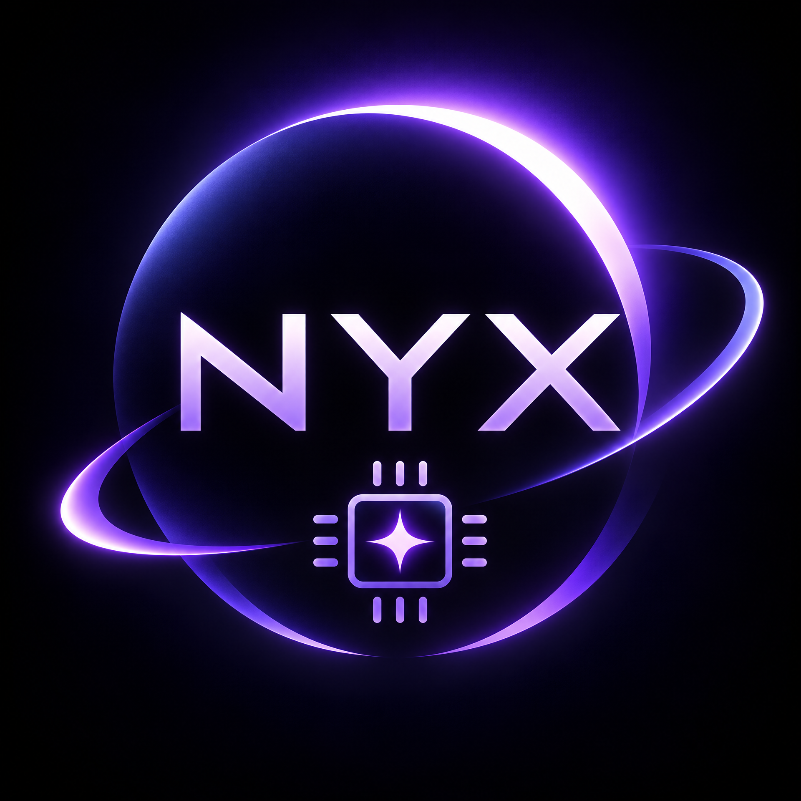

<div align="center">



# NYX ECLIPSE AI

### Your Intelligence. Your Device. Your Rules.

**Your autonomous AI workstation, entirely on Android.**

**Local intelligence. Independent execution. Real deliverables.**

[](https://github.com/ShamelesAbyss/Nyx/releases/tag/v0.8.9)
[](#-requirements)
[](#%E2%80%8D-build-from-source)

[](LICENSE)
[](#-requirements)
[](#local-first-not-cloud-first)

[**Workbench**](#%EF%B8%8F-project-workbench) · [**Getting started**](#-getting-started) · [**Known limits**](#-known-limitations) · [**Build**](#%E2%80%8D-build-from-source) · [**History**](#-release-history)

</div>

---

> [!IMPORTANT]
> **NYX v0.8.9 — Project Workbench** connects guarded research, objective-specific private workspaces, generated files and verification into retained work products. Markdown/text, CSV, JSON, static HTML and artifact ZIPs can be inspected and handed back through Android save/share controls. **1,034 JVM tests across 107 classes pass, with zero failures, errors or skips; the clean build completed in 1m 53s.** Read the [official release notes](RELEASE_NOTES_v0.8.9.md) and [implementation report, format matrix and device procedure](V089_IMPLEMENTATION_REPORT.md). Host verification is not physical-device or real-model validation; see [known limitations](#-known-limitations).

> [!WARNING]
> **The APK is ARM64-only and debug-signed.** It is a development build, not a Play Store or production-signed release. Install it only on a 64-bit ARM Android device. Existing NYX installations signed with the established debug certificate can update in place; back up anything important before experimenting.

## ⬇️ Download NYX v0.8.9 — Project Workbench

<div align="center">

### [**Get the latest release →**](https://github.com/ShamelesAbyss/Nyx/releases/tag/v0.8.9)

| Asset | What it is |
| :--- | :--- |
| **[NYX-v0.8.9.apk](https://github.com/ShamelesAbyss/Nyx/releases/download/v0.8.9/NYX-v0.8.9.apk)** | Primary installation APK. ARM64, debug-signed. |
| **[NYX-Source-v0.8.9.zip](https://github.com/ShamelesAbyss/Nyx/releases/download/v0.8.9/NYX-Source-v0.8.9.zip)** | Source, tests, docs, licenses and Gradle wrapper; excludes private files, models, caches and build outputs. |
| **[NYX-v0.8.9-androidTest.apk](https://github.com/ShamelesAbyss/Nyx/releases/download/v0.8.9/NYX-v0.8.9-androidTest.apk)** | Instrumentation tests for device verification; compiled, not executed on hardware. |
| **[NYX-v0.8.9-acceptance.zip](https://github.com/ShamelesAbyss/Nyx/releases/download/v0.8.9/NYX-v0.8.9-acceptance.zip)** | Deterministic Linux-host acceptance evidence: retained public sources and validated outputs, **not real-model synthesis or Android hardware execution**. |
| **[NYX-v0.8.9-SHA256SUMS.txt](https://github.com/ShamelesAbyss/Nyx/releases/download/v0.8.9/NYX-v0.8.9-SHA256SUMS.txt)** | Integrity manifest for this five-asset release: SHA-256 digests for both APKs, the source archive and acceptance bundle. |

</div>

No account, subscription, or mandatory cloud service is required. Model weights are not distributed with NYX; bring a compatible GGUF or connect to a local server.

---

## 🌒 The short version

NYX is not a chat wrapper around a hosted API. It is a local-first Android workstation that can hold a long-running objective, plan bounded work, run permission-scoped tools, and retain actual deliverables with evidence of how they were created.

It is also a private inference workstation. Run a quantized GGUF through the bundled llama.cpp CPU runtime, connect to a managed Ollama server, or point NYX at any OpenAI-compatible endpoint. Chat, agents, workflows, and autonomous objectives all resolve through the same provider layer, so no single cloud vendor is the only path.

**Project Workbench adds persistent work products, not just another planning strategy.** Research sources and selected documents become retained inputs; generated files become owned, checksum-verified artifacts with read-only preview, save and share controls. It uses NYX's existing objective engine, task history, checkpoints and verifier. Terminal development remains a separate objective path; one Workbench objective does not yet compile a terminal project and produce app-private deliverables together.

| | |
| :--- | :--- |
| **Package** | `com.nyx.ai` |
| **Version** | `0.8.9` (versionCode 22) |
| **Android** | 8.0+ / API 26–37 |
| **Architecture** | `arm64-v8a` |
| **Inference** | Native GGUF CPU · Ollama · OpenAI-compatible `/v1` |
| **License** | Apache-2.0 |

---

## ✨ Current capabilities

### 🛠️ Project Workbench

**An objective becomes a retained workspace and real files you can inspect.** Open **Autonomy → Workbench**, select an existing model and agent, describe a deliverable, choose its basename and format, and explicitly authorize app-private artifact tools. Optionally import a selected text document and approve exact research URLs.

Each objective owns a private directory with retained sources, imports and an artifact manifest. Atomic writes, path checks, quotas, exact-name conflict refusal and recorded checksums keep files tied to their objective and task. Completion requires the requested filenames, verified current bytes and matching successful-task write evidence—not a model's `DONE` claim. Reopening a workspace preserves results; it does not silently resume uncertain work.

Read-only previews, **Save as** through Android's document picker and **Share** through a narrowly scoped content URI operate only on verified artifacts. Sources and imported documents remain private inputs, not implicit exports. These Android handoff controls are implemented and build-tested; physical-device validation is outstanding.

### 🌐 Research & Evidence

Collect multiple explicitly selected public HTTPS sources through NYX's guarded fetcher. Exact-URL approval, credential refusal, DNS/private-address checks, same-origin redirect validation, response budgets, cancellation and per-host pacing constrain retrieval. Candidate links are shown, not automatically followed; generic web search is not implemented.

Retained source bytes, URLs, available metadata and digests support traceable Markdown and structured outputs. **Every selected source must be successfully retained with a matching checksum before a research objective can finish.** Pages and imported documents are untrusted data: they cannot grant tools, authorize new URLs or become trusted instructions. Provenance checks do not establish factual accuracy or the semantic correctness of citations.

### 📁 Real File Generation

| Deliverable | What NYX validates and previews |
| :--- | :--- |
| **Markdown / plain text** (`.md`, `.txt`) | Strict UTF-8, nonblank bounded content; selectable text preview |
| **CSV** (`.csv`) | Quoted-field parsing, consistent columns and a header; text preview |
| **JSON** (`.json`) | Actual parser-backed syntax/structure checks with bounded depth and values; text preview |
| **Static HTML** (`.html`) | Conservative standalone markup with no scripts, events, active URLs or external assets; **inert source-text preview, not a browser** |
| **Artifact bundle** (`.zip`) | Selected verified outputs with an artifact-only manifest and README; ZIP/CRC/path/expanded-size validation and metadata preview |

Generated files are tracked by objective/task ownership, byte size and SHA-256. User-selected Markdown, text, CSV and JSON imports are validated and copied into private storage; there is no phone-wide scan. PDF generation/extraction and XLSX/PPTX support are deferred. ZIPs do not include private sources/imports, arbitrary paths or nested artifact bundles.

### 🧠 Model-Agnostic Intelligence

Use **Ollama model selection**, bundled **native GGUF CPU inference**, or a configured **OpenAI-compatible `/v1` endpoint**. Import a compatible small quantized model for local drafting, summarizing, extraction and focused coding help; basic native chat needs neither Termux nor a subscription. No model weights are bundled, and a phone is not a frontier-model replacement.

Capability-aware diagnostics record observed constrained JSON, reasoning streams and request statistics for the selected provider/model/context/thread identity. **Direct, Incremental, Full and Guided** planning strategies use that evidence instead of assuming every model can use tools. Direct start is narrow and text-only; Guided is inference-only and cannot execute privileged artifact workflows. Individual models are not equally capable, and real-model Workbench outcomes on Android remain unverified.

### 🤖 Autonomous Execution

Existing permission-scoped tools can inspect and edit approved workspace files, run policy-gated commands through verified **Termux or Debian PRoot**, and build/test supported projects. Dependency-aware scheduling, workspace leases, task-bound evidence, durable worker history and checkpoints keep operations independently tracked. Multiple authorized terminal operations can overlap when mode, resources and conflicts allow; Linux-host tests demonstrated three overlapping processes, not Android concurrency.

The Live Worker Console shows plans, tool calls, terminal output, verification evidence and recovery decisions. Workbench uses the same engine but narrower artifact/research authorization; its objectives exclude general terminal/network/gateway tools that could bypass that scope. Mutating work with uncertain state requires explicit review, not automatic replay. No root, hidden permission bypass or arbitrary model-authored shell execution is enabled.

### 📱 Android-First Engineering

Native Kotlin/Compose layouts adapt from standard phones to expanded-width and foldable app windows, with keyboard-aware editing and a full-screen draft editor. **ARM64, Android 8.0+ / API 26–37** is the supported target; hinge-aware panes and physical fold/unfold reliability are not claimed.

**Eco, Balanced, Performance and Adaptive** modes bound threads, worker concurrency, stream cadence and idle release under thermal, battery and memory ceilings. **Quick, Standard, Patient, Extended and Custom** execution profiles separately control finite request allowances. Calibration is opt-in and bounded; exact-prefix native prompt reuse clears on mismatch or failure. No quantitative speed or battery improvement has been demonstrated.

Your device, your models, your data, your rules. NYX is open source and designed to work without an account or mandatory cloud service. Remote providers and approved public-URL research use the network by choice; local inference remains a first-class path.

---

## 🛰️ Project Insight — v0.8.8 foundation
**Plan less, start sooner, and show the model actually working.**

### 🧭 Capability-aware planning
NYX learns a bounded capability profile for the selected provider, model, context and thread configuration: whether constrained JSON output was demonstrated, whether provider statistics exist, whether a reasoning stream appeared, and the measured first-text and throughput of real requests. Profiles are cached for 24 hours, keyed by that exact identity, and discarded when the identity or configuration changes. A tiny JSON sample is evidence, not a promise of general schema enforcement.

### 🚀 Direct start for simple goals
A short, explicitly text-only objective no longer waits for a planning model. NYX creates one deterministic inference task, verifies that a non-empty answer exists, and starts immediately. Anything mentioning files, commands, builds, tests, installation, browsing or publication still goes through planning and every existing authorization gate.

### 🪜 Incremental plans that grow only after verified work
For tool-oriented, complex, slow or unproven models, NYX requests at most two small validated steps, executes them, and only after their local evidence passes asks for one more step — up to six continuations. The model never supplies identifiers, dependencies or permissions; NYX assigns them. A malformed, unauthorized or unavailable-worker decision stops the objective for review instead of inventing work.

### 🧠 Reasoning is progress, not silence
Ollama's separate `thinking` channel and OpenAI-compatible `reasoning_content` deltas are observed as activity without being appended to the answer or treated as a plan. The console reports reasoning characters and elapsed time, so a thinking model no longer looks stalled. Once a reasoning stream has actually been observed for a model, structured planning requests that model with thinking disabled; chat behavior is unchanged.

### 🤖 Autonomous execution, unchanged and still strict
Existing task scheduling, dependency-aware ordering, workspace leases, durable checkpoints and recovery remain in force. Every tool result is still verified locally before a task counts as complete, and a model cannot promote its own claim into evidence. Termux and Debian PRoot execution, concurrent independent operations and the Live Worker Console are unchanged.

### 📱 Mobile-first AI, model-agnostic by design
NYX runs local Ollama, native GGUF and OpenAI-compatible providers through one inference layer. Android phone and foldable layouts, patient execution profiles, hardware-aware performance modes, thermal and battery ceilings, and Eco idle release remain part of the runtime. The architecture is model-agnostic, but individual models are not equally capable: **not every Ollama model can plan reliably or use tools autonomously**, and NYX records observed capability instead of assuming it.

### 🛡️ Guided mode is deliberately narrow
A model that has not demonstrated constrained JSON can still contribute through one-line, validated `NEXT inference: …` decisions. Guided mode is inference-only: plain text cannot carry the local evidence that a tool task requires, so NYX does not let it request terminal, filesystem or development work. Unknown capabilities remain unknown; they never silently become permissions.

---

## 🌑⚡ Project Breakthrough — v0.8.7 foundation

**One phone. Patient intelligence. Multiple independently tracked workers.**

### 📱 Android & foldable usability

One root keyboard-inset owner, bounded multiline fields and a selection-preserving full-screen draft editor improve long objective, chat and terminal editing. Done/Back return text without submission. Nonsecret drafts use saved state; secret inputs remain memory-only. Fold/unfold and software-keyboard behavior still need hardware confirmation.

### 🧠 Patient local intelligence

Quick, Standard, Patient, Extended and Custom execution profiles are separate from energy mode. Standard allows 30-minute requests, Patient 60 minutes and explicitly approved Extended up to 120 minutes. First-text, inactivity and hard deadlines are distinct. Custom cumulative allowances stay finite and checkpointed; long settings do not waive Android foreground limits or authorize shell commands.

### ⚡ Efficient autonomous planning

Capability-sensitive prompts use smaller validated text/compact task schemas, bounded output and context, and provider-aware request limits. Only a complete valid plan can execute. Genuine text drives request-local visibility; keepalive frames do not. Serialized prompt bytes are reduced in deterministic fixtures, but no hardware speedup is claimed.

### 🤖 Parallel terminal workers

Support for **at least three independent authorized operations when resources, mode and conflicts allow** comes with unique IDs and isolated stdout, stderr and exit status. Requested capacity is configurable 1–8, default 3, subject to resource guards; Balanced may admit two. Terminal and Mission Control expose active, queued and uncertain lanes. Host tests demonstrated three overlapping processes; Android/Termux concurrency remains unverified. These are finite background commands, not persistent interactive sessions.

### 🔄 Reliable autonomous execution

Per-task providers and evidence drains prevent one worker's output from satisfying another's verification. Dependency-ready reservations and workspace read/write leases protect ordering, edits and builds. Conflicting work remains serialized; inference is independently bounded. Durable checkpoints, process ownership, exact permissions and explicit uncertainty review remain in place.

### 🔋 Adaptive mobile performance

Eco, Balanced, Performance and Adaptive remain hardware-aware. Memory headroom, battery and thermal protections cap concurrency instead of blindly maximizing workers. No measured battery improvement is claimed.

### 🔥 Project Ignition — now included publicly

The previously unpublished v0.8.6 work is carried forward: compact complete-plan validation, stream-aware lifecycle diagnostics, provider-specific schema/output bounds, the optional tiny Models diagnostic, and standalone **Kotlin CLI / Java JVM** development. Dependencies follow actual planned tasks on creation and resume; ordinary shell goals and negated Android instructions do not demand an Android SDK. Linux calculator fixtures compile and run behavioral tests; this is not proof of end-to-end qwen project creation on a phone.

---

## 🛡️ Project Sovereign — retained foundation

**Project Sovereign is about making autonomous work survive real models, long runs, and its own mistakes.**

NYX already planned objectives, ran authorized tools, and checked evidence. Sovereign added the layer that keeps those loops coherent when the context is compacted, a tool fails, a model repeats itself, or a process restarts. It remains an engineering foundation for reliable autonomous execution — not a claim of unbounded or Manus-style autonomy.

### 🧠 Adaptive deliberation

NYX assigns a bounded reasoning depth and hard model, tool, step, and context budgets from the task kind, its complexity, and the observed performance mode. Light tasks get fewer calls; development, diagnosis, and verification get more. The model receives a short operating protocol asking for one decision and one observation at a time — never a hidden chain-of-thought transcript.

### 🤖 Intelligent agent execution

Each task runs a structured loop: plan the next action, invoke only an authorized tool, record the observation, evaluate whether the evidence supports progress, and verify before completion. The planner sees the tools actually enabled for the run instead of guessing at capabilities.

### 🛡️ Evidence-backed completion

For tasks that require tool evidence, a final answer that claims concrete work without a successful tool observation is rejected and the model is asked for evidence or an honest blocker. If it repeats the claim, the result is marked unverified and objective verification fails. An honest blocker is not treated as a completion claim.

### 🔄 Bounded self-correction

Malformed structured actions get at most two repair attempts, each recorded. Repeated identical failing actions stop with an explanation, and consecutive tool failures stop the task before it burns the whole budget. Retries receive the previous failure evidence and an explicit instruction to change approach.

### 💾 Durable working state

Each task persists a compact working state: objective, requirements, established facts, open errors, next action, evidence pointers, and completed steps. It is restored from the task checkpoint after a retry or process restart and included in bounded context. A long objective no longer depends on an ever-growing chat transcript.

### 🔐 Task-scoped capabilities

Tools follow the planned task, not the widest capability the app happens to have:

| Task kind | Allowed capability |
| :--- | :--- |
| Inference | Read-only grounding and enabled non-mutating tools; no shell, file writes, or project execution |
| Filesystem | File inspection and atomic edits; no shell commands or project builds |
| Verification | Read-only inspection plus the fixed test command; no file writes or arbitrary shell |
| Terminal | File tools and policy-gated shell commands inside the authorized workspace |
| Development | Full approved development capability set |

Every scope is intersected with tools actually available on the run, so a missing terminal never becomes a phantom capability.

### ⚡ Resource-aware autonomy

Sovereign reasoning and execution integrate with Project Endurance's Eco, Balanced, Performance, and Adaptive modes. Eco reduces budgets and can release an idle native model; Performance may raise them within fixed caps. Thermal, battery, and memory safeguards still apply.

### Long-running execution

The foreground objective watchdog now allows up to two hours, while the existing lease heartbeat still pauses on thermal, memory, or battery pressure. Checkpoints are written before and after verification, and uncertain mutating work still requires explicit review.

### Performance foundation from v0.8.4

The hardware-aware layer introduced in Project Endurance remains in place.

### Four operating modes

| Mode | Best for | What it changes |
| :--- | :--- | :--- |
| 🔋 **Eco** | Long battery life, small devices, background work | At most two native threads, one autonomous worker, slower UI stream coalescing, and release of the resident native model after ten idle minutes. |
| ⚖️ **Balanced** | Everyday chat and objectives | Moderate native threading, up to two autonomous workers, and 60 ms stream coalescing. |
| ⚡ **Performance** | Fast local generation on capable hardware | More native threads, up to four autonomous workers when the device can sustain them, and 33 ms stream coalescing. |
| 🧠 **Adaptive** | A sensible default across devices | Chooses a level from RAM, low-RAM state, core count, thermal status, and battery state, with hysteresis to avoid oscillation. |

Thermal and battery safety ceilings override every mode. A critical thermal reading or a nearly empty unplugged battery derates the runtime even if Performance was selected. Derating is immediate; upgrading waits for two consecutive observations.

### Device intelligence, not device guesses

The Performance dashboard reports what NYX can actually observe from documented Android and Linux interfaces:

- manufacturer, model, SoC manufacturer/model, hardware, Android release, API level, and supported ABIs;
- logical cores, estimated performance/efficiency core split, maximum observed CPU frequency, and optional CPU flags such as `dotprod`, `i8mm`, `bf16`, and SVE;
- total and available RAM, Android memory class, and the low-RAM flag;
- battery percentage and charging state, `PowerManager` thermal status on Android 10+, display metrics, smallest width, and a hinge/large-screen hint;
- media performance class, NNAPI system-feature presence, and Vulkan feature version when reported.

Missing evidence is labeled unavailable rather than guessed. SoC family labels such as Tensor G5/G4/G3 or Snapdragon 8 Elite are **display and thread heuristics**, not proof that a vendor GPU, NPU, or runtime can accelerate GGUF inference.

### Adaptive threading at safe boundaries

The selected mode's thread count is used before the next native model load. A model that is already resident keeps its exact existing thread count, so a chat turn cannot silently reload the model or change the session underneath a generation.

- The manual **CPU threads** slider in Settings is authoritative and switches adaptive threading off.
- **Apply to native session** reloads the resident model only when no generation, agent, workflow, or objective is running.
- Context length is not silently changed or truncated.

### Calibration with a stop button

Calibration is opt-in and measures real native inference against the currently loaded model:

- at most three thread configurations, derived from the current setting and observed performance-core count;
- at most eight generated tokens per configuration;
- a 120-second total budget, with a thermal recheck between candidates;
- refusal without a loaded native model, during an objective, on a hot device, or on a low unplugged battery;
- restoration of the original configuration in a non-cancellable `finally` path;
- on-device provenance: model path and size, runtime version, device fingerprint, load time, generated tokens, end-to-end tokens/s, thermal/battery conditions, and timestamp.

Results are invalidated when the model, runtime version, or device fingerprint changes, and measurements taken under thermal or battery pressure are not used for tuning. "Tokens/s" is end-to-end throughput for a fixed short prompt, including prompt processing; it is not a decode-only synthetic benchmark.

### Safer native prompt reuse

The native session records the exact token IDs represented in its single-sequence KV memory. On the next generation it finds the longest exact prefix shared with the new formatted prompt and removes only the divergent tail with `llama_memory_seq_rm`. At least one prompt token is always decoded so logits exist for the first sample.

Any mismatch, failed sequence removal, cancellation, decode error, or failed generation clears both the KV memory and the token cache. No prompt history is truncated, slid, or silently rewritten. If reuse is not possible, the existing full-prompt path runs exactly as before.

### What is experimental — and what is not claimed

> [!NOTE]
> **Project Sovereign is build- and JVM-tested, not physically validated in this cycle.** Adaptive deliberation, task-scoped tools, the false-success guard, and durable working state have no on-device run against a real provider or model yet. "Replanning" here means bounded plan repair plus changed-approach retry guidance, not an unrestricted planner loop. No speed, battery, or success-rate benchmark is claimed.
>
> **Native CPU inference remains the verified GGUF backend.** No GPU or NPU GGUF backend is bundled or claimed. NNAPI/Vulkan feature presence is capability evidence, not a compatibility promise.
>
> Exact-prefix KV reuse is implemented and compiled, but it has **no measured device speedup** and no physical-device runtime test yet. Calibration has not been run on a phone with a real GGUF model. Battery or speed improvements have not been quantitatively established.
>
> In an earlier cycle, the release owner reported opening the Performance dashboard on a Pixel 10 Pro Fold. That is **past UI evidence only**; it does not validate Workbench, native model loading, calibration, KV reuse or battery life.

---

## 🧩 What makes NYX different

### Local-first, not cloud-first

Native GGUF inference runs through a bundled llama.cpp runtime and JNI. Basic chat does not require Termux, a network connection, an account, or a paid API. Ollama and OpenAI-compatible endpoints are available when you want them, but they are not the only path.

### One provider layer, several ways to run a model

- **Native GGUF** — import a model through the Android file picker, inspect its metadata and memory estimate, then load, stream, stop, unload, or delete the private copy.
- **Ollama** — connect to a local server on loopback or your network, including a managed Termux or Debian/PRoot-hosted server.
- **OpenAI-compatible `/v1`** — point at any compatible chat-completions server.

### Autonomy with evidence

NYX persists objectives and tasks in Room, plans a validated dependency graph, schedules only dependency-ready work, records tool observations, and evaluates declared evidence before a task may complete. A model's prose is never accepted as proof. Read-only work may retry; anything that may have changed state requires explicit human review.

### Real Android execution

- Termux command bridge over the documented `RUN_COMMAND` intent, with real stdout, stderr, and exit codes.
- Verified Termux host and Debian PRoot guest discovery, with inherited-binary and origin checks.
- Workspace-scoped file tools, explicit workspace authorization, a managed registry, and guarded deletion.
- Task-scoped dependency preparation: only the toolchain actually required by planned work is checked; ordinary shell objectives are not blocked by Android SDK or Gradle.
- Build and test commands fixed by detected project markers — a model cannot substitute its own shell text.

### Safety and control

- Manual, Smart, and Full autonomy modes, with scoped, revocable grants.
- Central risk classification for terminal commands, file changes, package installs, network access, publishing, credentials, and delegated work.
- Emergency Stop that denies new actions immediately and remains active across restarts.
- No root, no hidden APIs, no permission bypass, and no arbitrary model-authored shell execution.
- Gateway tokens use Android Keystore-backed storage; credentials remain references, not plaintext records.

### Android-native experience

Kotlin and Jetpack Compose, with no web wrapper. A phone-first layout with bottom navigation, an expanded-width navigation rail, and split panes for agents and workflows. Standard phones and foldables use the same adaptive app window; a hinge-aware two-pane layout is not claimed. Dark violet visual identity, branded launcher icon, edge-to-edge insets, API 37 target, and minimum API 26.

### Local network and research tools

- `fetch_url` for public documentation and research, HTTPS-only, with private-address, loopback-pivot, and redirect re-validation.
- Arsenal: versioned offline procedures with relevance-bounded injection and untrusted-import validation.
- Gateways: streamable-HTTP MCP and GitHub tools behind per-server allowlists, budgets, timeouts, and redacted logs.
- Project memory: evidence-hashed verified outcomes and lessons injected into later objectives.
- Source symbol index and bounded repair loop for development work.

---

## 🗺️ How NYX works


The engine plans one bounded task graph, runs only dependency-ready tasks within device limits, records every tool observation, and evaluates declared evidence before a task may complete. A model's claim of success is never accepted as proof.

---

## 🚀 Getting started

NYX supports two independent ways to run a model. You do not need both, and native inference does not require Termux.

### Option A — Native GGUF mode (no Termux, no network)

1. Install `NYX-v0.8.9.apk` on a 64-bit ARM Android device running Android 8.0 (API 26) or newer.
2. Obtain a compatible instruct-tuned GGUF file. Start small: a 0.5B–3B model quantized to `Q4_K_M` is a realistic first test. Memory use grows with parameter count and context length.
3. Open **Models → Import GGUF** and pick the file with the Android document picker. NYX copies it into app-private storage and reads its metadata.
4. Review the reported architecture, quantization, context limit, and memory estimate. An incompatible or oversized model is refused rather than attempted.
5. Select the model, choose a context size and thread count, then **Load**.
6. Open **Chat** and send a short prompt. Streaming output can be stopped at any time.

> [!NOTE]
> **Native Android inference has not yet been verified on physical hardware at publication time.** The runtime generated real streamed tokens on a Linux x86_64 host using the same JNI bindings, and the ARM64 library cross-compiles and packages correctly, but on-device GGUF loading and generation still require confirmation. See [current status](#-current-status).

### Option B — Termux, Ollama, or a compatible server

1. Install [Termux](https://termux.dev/) and your preferred local inference server, following that project's own instructions.
2. In **Settings**, set the endpoint:
   - Ollama: `http://127.0.0.1:11434`
   - OpenAI-compatible: `http://127.0.0.1:8080/v1`
   - Or open **Models → Managed Ollama** and use **Start** to launch a Termux-hosted server without leaving NYX.
3. Tap **Connect** and choose a model from the discovered list.

For the optional terminal tools, all of the following are required — granting one permission does not complete the setup:

```properties
# ~/.termux/termux.properties
allow-external-apps=true
```

Restart Termux after editing the file, then grant NYX the `com.termux.permission.RUN_COMMAND` permission in Android settings. Finally, choose an explicit workspace directory inside NYX and enable terminal tools there.

For the optional Debian PRoot guest, install Termux and its `proot-distro` package from the Termux package manager, install or verify a Debian guest with `proot-distro`, then open **Autonomy → Terminal**, select **Debian PRoot**, and run environment detection so NYX verifies the guest alias before use. Do not try to build the Android app inside the ARM64 guest; use Android SDK/Gradle on a supported host. NYX does not require Debian for native GGUF inference or ordinary Chat.

> [!WARNING]
> Terminal tools are **off by default** and apply only to objectives in the workspace you approve. Enabling them authorizes bounded source edits and execution of the project's own build/test scripts. Those scripts run with Termux's authority and can reach other files or the network — approve only projects you trust. NYX never enables root and never commits or publishes. It installs only planner-generated packages approved by policy, never arbitrary model-authored install commands.

If a LAN server is used on Android 17, the system will also ask for the local-network permission; denying it leaves internet endpoints working while LAN access stops.

### Your first autonomous objective

1. Connect a local model in **Chat** and confirm it responds. Native GGUF, Ollama, and OpenAI-compatible local endpoints are separate provider choices.
2. Open **Autonomy → Terminal**, detect/select the Termux host or Debian environment, choose a trusted workspace path, and save it. Enable terminal tools only if the objective needs them; leave them off for planning or chat-only work.
3. Open **Autonomy → Objectives**, enter a small concrete goal and how success can be checked, then choose **Plan and execute**. Review the task plan and any permission or package-approval prompts.
4. Follow task events in **Live Activity**. NYX uses exit codes, files, and declared verification evidence—not the model's claim alone—to decide whether work is complete. If a required dependency is blocked, review `needs_attention` and resume after resolving it.

### Your first retained Workbench deliverable

1. Open **Autonomy → Workbench**, select a model and agent, and request a small output such as `report.md`. Choose its format and explicitly authorize app-private artifact tools; no Termux setup is needed for this path.
2. Optionally choose one supported text document and approve the exact public HTTPS URLs to collect. Review the request and any policy prompts before starting.
3. Inspect the retained source records, task evidence and verified output. Preview the file as inert text, **Save as** to a location you pick, or **Share** its checked snapshot. Reopen the objective to review retained results; review interruptions explicitly rather than assuming they resumed.

The new-objective UI starts with one import draft and one required output; the engine can track up to eight required files. Keep requests small and review generated content yourself. Workbench and terminal-development objectives are currently separate; Android handoff and real-model execution still need device validation.

See the [user guide](USER_GUIDE.md) for the full setup and safety boundaries.

---

## 📋 Requirements

| | |
| :--- | :--- |
| **OS** | Android 8.0 (API 26) or newer, up to API 37 |
| **Form factors** | Phone-first Compose layout with bottom navigation, expanded-width navigation rail, and split panes. Standard phones and foldables use the same adaptive app window; no hinge-aware/two-pane layout or foldable-device validation is claimed. |
| **CPU** | 64-bit ARM (`arm64-v8a`) — no x86 or 32-bit-only support |
| **Storage** | Roughly 2–4× the model file size free, plus workspace |
| **Memory** | Depends on model size and context; small models need ~1–2 GB of headroom |
| **Termux** | Optional, only for terminal tools and Debian PRoot workflows |

---

## 📊 Current status

This table separates what exists from what has actually been demonstrated. It is deliberately conservative.

| Status | Area |
| :--- | :--- |
| ✅ **Implemented and build-tested** | Workbench private stores/manifests, guarded research and source retention, selected text imports, validated artifacts, Android preview/save/share interfaces and conservative interruption reconciliation; capability-aware planning, reasoning visibility, native GGUF provider, model import and management, provider factory, inference admission, objective engine, scheduler, verifier, context store, Arsenal procedures, repair loop, Termux bridge, autonomy policy, dependency provisioning, network tools, specialist roles, Android 17 permission handling, managed Ollama lifecycle, MCP/GitHub gateways, project memory, source symbol index, Live Worker Console, device intelligence, operating modes, adaptive threading, bounded calibration, exact-prefix KV reuse, mode-aware concurrency and streaming, adaptive deliberation budgets, durable working state, task-scoped tool authority, false-success guard, bounded action repair |
| ✅ **v0.8.9 release artifacts** | ARM64 debug APK, instrumentation APK, source archive, deterministic Linux-host acceptance bundle and checksum manifest; **1,034 JVM tests across 107 classes, zero failures, errors or skips**. Instrumentation was compiled but not executed on hardware. |
| ✅ **Previous releases** | v0.8.8 Project Insight, v0.8.7 Project Breakthrough, v0.8.5 and earlier releases remain part of the project history; see the [release archive](https://github.com/ShamelesAbyss/Nyx/releases). |
| 📱 **Earlier owner-reported UI check** | Performance dashboard opened on a Pixel 10 Pro Fold in a previous cycle. This is UI evidence only, not a Workbench, native inference, calibration, KV-reuse or battery benchmark. |
| 🧪 **Verified on Linux host only** | Workbench filesystem, format, quota, ownership and interruption-recovery tests, including six AgentRunner-to-Workbench lifecycle tests. An opt-in trial retained three public HTTPS sources with matching checksums and produced Markdown, CSV, JSON and static HTML using deterministic extraction/fixture content—not model-driven research synthesis. |
| 🧪 **Verified on Linux host only** | Real llama.cpp JNI generation from an Apache-2.0 SmolLM2-135M Q4_K_M GGUF (`The capital of France is Paris.`, 7 selected tokens), plus cancellation, session reuse, callback-error propagation, and safe unload |
| 🧪 **Verified on Linux host only** | Autonomous repair of a genuinely failing fixture: baseline build `0`, baseline test `2`, exact-hash edit, retest build `0` / test `0`, with backup and diff retained |
| 📱 **Confirmed on the owner's Android 17 device** | Termux environment discovery (earlier development cycle) |
| ⏳ **Awaiting physical-device verification** | v0.8.9 real-Ollama Workbench execution, preview/save/share, foldable behavior and Android interruption recovery; inherited capability-profile learning, direct-start eligibility, incremental continuation and reasoning-stream visibility against real models; keyboard/foldable editing, slow-qwen planning, Android/Termux parallel operation lanes and checkpointed long allowances; native GGUF loading/generation, calibration, Eco idle release, adaptive thread application, exact-prefix KV reuse with a real model, Performance mode switching, Mission Control/Terminal rendering, task-scoped dependency preparation and objective resumption, fixed-build Debian JDK installation and continuation, workspace deletion/startup reuse, Debian-only Ollama lifecycle, notification actions, model listing, Arsenal/MCP/GitHub/memory/symbol flows, Termux IPC, Keystore, foreground service, process-death recovery and Room migration |
| 🗺️ **Planned** | See the [roadmap](#-roadmap) |

Artifact checks for v0.8.9: package `com.nyx.ai`, versionName `0.8.9`, versionCode `22`, target/compile SDK `37`, minimum SDK `26`, `arm64-v8a` only, unchanged debug signer and 16 KB ZIP alignment. Clean build passed in **1m 53s**; vendored llama.cpp remains unchanged. No Room migration or destructive change to existing models, workspaces or app data is introduced by Workbench. This is not a production-signed Play artifact. See [TEST_RESULTS.md](TEST_RESULTS.md), the [v0.8.9 checksums](https://github.com/ShamelesAbyss/Nyx/releases/download/v0.8.9/NYX-v0.8.9-SHA256SUMS.txt) and [acceptance evidence](https://github.com/ShamelesAbyss/Nyx/releases/download/v0.8.9/NYX-v0.8.9-acceptance.zip).

### 📋 Known limitations

- **Hardware and providers:** real Ollama-driven Workbench execution, Android preview/save/share, foldable usability and interruption recovery remain unverified. The public-source comparison used deterministic Linux extraction, not a model. Native Android GGUF execution and inherited provider/device flows still require physical confirmation; compiled instrumentation is not a device test.
- **Research is URL-driven and read-only:** generic web search, JavaScript/browser interaction and authenticated web automation are not implemented. Public HTTP retrieval cannot handle every modern site. PDF generation/extraction and complex Office formats are deferred.
- **Not one unrestricted workflow:** Guided inference-only models cannot execute privileged artifact work. Workbench deliverables and terminal project development are not yet combined into a single objective. Not every model can reliably plan or use tools.
- **Bounded storage and context:** imports have no semantic chunk index for large documents. Private objectives are quota-bound (40 artifacts, 8 MiB per artifact and a shared 32 MiB payload budget); there is no automatic destructive cleanup of completed objective data. Reopen is not resume, and Android foreground/resource limits still apply.
- **Evidence has limits:** valid formats, matching source checksums and successful write evidence prove retained bytes and provenance—not factual accuracy, useful content or semantically correct citations. Review the actual outputs. No quantitative speed, battery or completion-rate improvement is claimed.
- **Development distribution:** the APK is ARM64-only and debug-signed, not a production Play Store release.

---

## 🧭 Roadmap

These are goals, not completed capabilities.

- **Workbench reliability and integration** — validate save/share, foldable behavior and interruption recovery on Android with at least two real models; then improve multi-file requests, terminal-to-artifact integration and lifecycle cleanup controls.
- **Broader research and document support** — evaluate safe search/navigation, large-document retrieval and parser-backed PDF/Office support before making capability claims.
- **Native Android inference validation and optimization** — confirm real GGUF execution across devices, then tune threads, context, and memory behavior from measured evidence.
- **Improved autonomous software development** — stronger multi-file repair, better diagnosis, and reliable end-to-end completion on Android.
- **Better memory and inference resource management** — more accurate residency accounting and graceful degradation under pressure.
- **More reliable interruption recovery** — clearer ownership, resumable checkpoints, and safer restart decisions.
- **Expanded verified local skills** — more built-in, manifest-validated procedures with no hidden privilege escalation.
- **Improved accessibility and device compatibility** — broader hardware coverage, larger-text support, and clearer failure messaging.
- **Reproducible production release builds** — a documented, independently verifiable signing and release process.

### Toward 1.0 — direction, not readiness

v0.8.9 establishes retained, structurally verified work products on top of bounded planning and permission-scoped execution. A credible 1.0 needs repeatable physical-device and real-model outcomes, reliable Android file handoff and recovery, measured hardware compatibility, clearer lifecycle controls and a reproducible production-signing process. Those requirements remain open; NYX is **not being declared 1.0-ready**.

The long-term vision is an autonomous assistant that runs on hardware you own, uses tools you approve, shows its evidence, and stops when it cannot verify required work. NYX is an early step toward that vision, not a claim that structural evidence can prove every result correct.

---

## 📚 Release history

| Version | Codename | Focus |
| :--- | :--- | :--- |
| **[v0.8.9](https://github.com/ShamelesAbyss/Nyx/releases/tag/v0.8.9)** | **Project Workbench** | Objective-specific private workspaces, retained research/imports, validated deliverables, checksums and Android preview/save/share interfaces |
| **[v0.8.8](https://github.com/ShamelesAbyss/Nyx/releases/tag/v0.8.8)** | **Project Insight** | Capability-aware planning strategies, direct start for simple goals, bounded incremental continuation, reasoning-stream visibility |
| **[v0.8.7](https://github.com/ShamelesAbyss/Nyx/releases/tag/v0.8.7)** | **Project Breakthrough** | Keyboard/draft repair, patient inference, compact planning, isolated terminal workers; includes unpublished Project Ignition |
| **[v0.8.5](https://github.com/ShamelesAbyss/Nyx/releases/tag/v0.8.5)** | **Project Sovereign** | Adaptive deliberation budgets, durable working state, task-scoped tools, false-success guard, bounded self-repair, two-hour checkpointed execution |
| [v0.8.4](https://github.com/ShamelesAbyss/Nyx/releases/tag/v0.8.4) | Project Endurance | Device intelligence, Eco/Balanced/Performance/Adaptive modes, calibration, thermal/battery safety, exact-prefix KV reuse |
| [v0.8.3](https://github.com/ShamelesAbyss/Nyx/releases/tag/v0.8.3) | Project Mission Control | Mission overview, readiness evidence, task timeline, terminal clarity, console accessibility |
| [v0.8.2](https://github.com/ShamelesAbyss/Nyx/releases/tag/v0.8.2) | Project Unshackle | Task-scoped dependency preparation, negation-aware project inference, GitHub language presentation |
| [v0.8.1](https://github.com/ShamelesAbyss/Nyx/releases/tag/v0.8.1) | Project Clear Signal | Run-scoped Live Worker Console, operation grouping, bounded planning recovery, shell hardening |
| [v0.8.0](https://github.com/ShamelesAbyss/Nyx/releases/tag/v0.8.0) | Project Autonomous Bootstrap | Dependency bootstrap, Debian Deb822/JDK fix, policy-gated terminal, workspace lifecycle |
| [v0.7.9](https://github.com/ShamelesAbyss/Nyx/releases/tag/v0.7.9) | Project Persistence | Durable Debian/PRoot Ollama lifecycle, foreground ownership, verified readiness and stop |
| [v0.7.7](https://github.com/ShamelesAbyss/Nyx/releases/tag/v0.7.7) | Project Liberation | Debian-aware Ollama, guest lifecycle safety, repeated Full-Autonomy projects |

See [CHANGELOG.md](CHANGELOG.md) for the complete history.

---

## 🧑‍💻 Build from source

Requirements: JDK 17 or newer, Android SDK with API 37 and Build Tools 36.0.0, NDK 28.2.13676358, CMake 3.22.1, and Python 3 for the SDK policy checks.

```bash
git clone https://github.com/ShamelesAbyss/Nyx.git
cd Nyx
export ANDROID_HOME="$HOME/Android/Sdk"
export JAVA_HOME=/path/to/jdk-21
./gradlew --no-daemon testDebugUnitTest assembleDebug assembleDebugAndroidTest
```

The APK is written to `app/build/outputs/apk/debug/app-debug.apk`. The native runtime is built for `arm64-v8a` only. Full instructions, including SDK policy guards, signing boundaries, and instrumentation commands, are in [BUILD.md](BUILD.md).

### Documentation

| Document | Contents |
| :--- | :--- |
| [BUILD.md](BUILD.md) | Toolchain, reproducible builds, tests, signing, packaging |
| [USER_GUIDE.md](USER_GUIDE.md) | Setup, models, agents, objectives, terminal, troubleshooting |
| [NYX_DEVELOPMENT_REPORT.md](NYX_DEVELOPMENT_REPORT.md) | What was built, what was verified, what remains |
| [TEST_RESULTS.md](TEST_RESULTS.md) | Exact test counts, host evidence, and unexecuted device checks |
| [CHANGELOG.md](CHANGELOG.md) | Complete release history |
| [RELEASE_NOTES_v0.8.9.md](RELEASE_NOTES_v0.8.9.md) | Current Project Workbench release: retained deliverables, research, verification and limits |
| [V089_IMPLEMENTATION_REPORT.md](V089_IMPLEMENTATION_REPORT.md) | Workbench technical scope, format matrix, host evidence and device procedure |
| [RELEASE_NOTES_v0.8.8.md](RELEASE_NOTES_v0.8.8.md) | Insight scope, strategy rules, verification and limits |
| [V088_IMPLEMENTATION_REPORT.md](V088_IMPLEMENTATION_REPORT.md) | Capability model, planning strategies and device procedure |
| [RELEASE_NOTES_v0.8.7.md](RELEASE_NOTES_v0.8.7.md) | Breakthrough + Ignition scope, verification and limits |
| [V087_IMPLEMENTATION_REPORT.md](V087_IMPLEMENTATION_REPORT.md) | Execution policies, isolation, source findings and device procedure |
| [V086_IMPLEMENTATION_REPORT.md](V086_IMPLEMENTATION_REPORT.md) | Inherited Ignition engineering history |
| [RELEASE_NOTES_v0.8.5.md](RELEASE_NOTES_v0.8.5.md) | Historical Project Sovereign release |
| [V085_IMPLEMENTATION_REPORT.md](V085_IMPLEMENTATION_REPORT.md) | Sovereign execution implementation, safety invariants, test evidence, and device checklist |

<details>
<summary><strong>Historical release and implementation documents</strong></summary>

| Document | Contents |
| :--- | :--- |
| [RELEASE_NOTES_v0.8.3.md](RELEASE_NOTES_v0.8.3.md) | v0.8.3 Project Mission Control |
| [V083_IMPLEMENTATION_REPORT.md](V083_IMPLEMENTATION_REPORT.md) | v0.8.3 implementation and device checks |
| [RELEASE_NOTES_v0.8.2.md](RELEASE_NOTES_v0.8.2.md) | v0.8.2 Project Unshackle |
| [V082_IMPLEMENTATION_REPORT.md](V082_IMPLEMENTATION_REPORT.md) | v0.8.2 dependency classification and gate |
| [RELEASE_NOTES_v0.8.1.md](RELEASE_NOTES_v0.8.1.md) | v0.8.1 Project Clear Signal |
| [RELEASE_NOTES_v0.8.0.md](RELEASE_NOTES_v0.8.0.md) | v0.8.0 Project Autonomous Bootstrap |
| [V080_LIVE_WORKSPACE_REPORT.md](V080_LIVE_WORKSPACE_REPORT.md) | v0.8.0 live console and workspace lifecycle |
| [docs/V081_IMPLEMENTATION_STATUS.md](docs/V081_IMPLEMENTATION_STATUS.md) | v0.8.1 console and planning implementation |
| [ENGINEERING_STANDARDS.md](ENGINEERING_STANDARDS.md) | Permanent SDK and compatibility policy |
| [PLATFORM_NOTES.md](PLATFORM_NOTES.md) | Android and Termux platform constraints |
| [docs/](docs/) | Native inference, development engine, context and skills, Android compatibility |

</details>

### Contributing

Contributions are welcome from Android engineers, local-model researchers, and anyone who wants private AI to work well on real hardware.

- **Bugs and feature requests:** open an [issue](https://github.com/ShamelesAbyss/Nyx/issues) with device, Android version, model file, and reproduction steps.
- **Pull requests:** keep changes focused, preserve the existing architecture, and include tests for deterministic logic.
- **Claims:** report what you actually observed. A build that compiles is not a device validation, and a model that sounds confident is not evidence.

No formal contribution process, CLA, or governance structure is documented beyond the above; treat this as an early-stage project.

### License and attribution

NYX is released under the [Apache License 2.0](LICENSE). The bundled llama.cpp runtime retains its own upstream license and attribution, included in the source archive. Model weights are **not** distributed with NYX; obtain them under terms that permit your use.

---

<div align="center">

## Your Intelligence. Your Device. Your Rules.

**NYX Eclipse AI** · built for the hardware you already own.

<sub>v0.8.9 — Project Workbench · Apache-2.0 · ARM64 · API 26+</sub>

</div>
